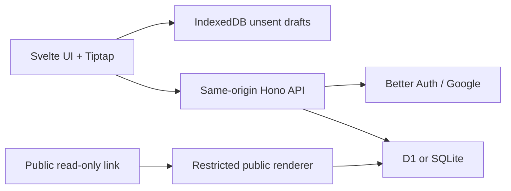

# Implementation plan

Status: technical design for the confirmed [product specification](product-spec.md). The local M02 prototype is implemented; [feasibility results](feasibility.md) distinguish completed checks from pending live tests. Research checked 2026-11-16.

## Recommended architecture

Use TypeScript, Svelte 5 + Vite, the open-source Tiptap editor, Hono, Better Auth, and Drizzle. Prefer Cloudflare Workers Static Assets + Workers Free + D1 if the feasibility gate passes. Otherwise deploy the same domain model to the Raspberry Pi with Node.js, SQLite, and Docker Compose. Implement one deployment first.



The public renderer and private API are routes in one application, not independent services. Private UI is a client app; the public page returns safe rendered HTML without shipping the editor. Static assets may be cached; private responses and shared page content are not CDN-cached initially.

## Technology choices and alternatives

| Concern | Proposed choice and why | Considered alternatives and why not first |
| --- | --- | --- |
| Language | TypeScript: shared content/API types catch mistakes during development; types are erased from browser output. Validate network data separately. | JavaScript needs more discipline for changing contracts. Go/Rust can produce efficient servers but introduce a second language and do not solve browser editor cost. Python is viable but adds a separate type/tooling boundary. |
| UI | Svelte 5 + Vite, small components and ordinary CSS. Svelte compiles components into browser code; this fits a lightweight interface. [Svelte overview](https://svelte.dev/docs/svelte/overview). | React + Vite has a larger ecosystem and contributor pool; use it if maintainability or the editor spike justifies it. No claim that Svelte automatically makes typing faster. Next.js/SSR for the private editor adds server work with little initial benefit; SvelteKit is reasonable if richer routing/server rendering becomes useful. |
| Editor | Tiptap over ProseMirror, headless and modular. Add only the required open-source extensions; build a small toolbar/Insert menu. [Tiptap overview](https://tiptap.dev/docs/editor/getting-started/overview). | Direct ProseMirror adds editor integration work. Lexical deserves a spike if Tiptap misses budgets. Milkdown is attractive if Markdown source fidelity becomes the top priority. CodeMirror with preview exposes syntax to non-developers. A custom contenteditable editor makes IME, undo, selection, and tables our responsibility. |
| Content | Schema-versioned editor JSON as canonical content, Markdown import/export for a defined subset. Avoid parsing and serializing Markdown on each save. | Markdown as the sole canonical format is simpler for file editing but can lose structure or formatting through repeated conversion. Stored HTML increases sanitization burden and does not provide a strong editing schema. |
| API | Hono and ordinary JSON endpoints, runtime validation at the boundary. Web-standard request handling keeps deployment options open. [Hono documentation](https://hono.dev/docs). | Express is reasonable for Pi-only hosting but less portable to Workers. GraphQL and microservices add contracts and operations that this app does not need. |
| Authentication | Better Auth with only Google enabled, database sessions, and its Drizzle adapter. It integrates with Hono; verify the selected runtime/provider configuration. [Hono integration](https://better-auth.com/docs/integrations/hono). | Handwritten OAuth/session management adds security-sensitive work. Hosted authentication introduces another provider and quota dependency. Auth.js remains an alternative if Better Auth fails the spike. |
| Database | Drizzle schema/migrations and SQLite on Pi or D1 on Cloudflare. Ownership, page hierarchy, sessions, and share grants fit relational constraints. [D1 adapter](https://orm.drizzle.team/docs/sqlite/connect-cloudflare-d1). | PostgreSQL is a strong later choice for higher write concurrency and richer search, but adds an operated or hosted database. KV is not the primary store for transactional note updates. A filesystem of Markdown files complicates ownership, atomic hierarchy changes, and concurrent requests. |
| Browser recovery | IndexedDB with a small wrapper for unsent drafts, scoped by account/page. | localStorage is synchronous and unsuitable for larger drafts. Full offline synchronization/CRDTs are beyond the confirmed need. |
| Tests/tooling | pnpm lockfile, strict TypeScript, Vitest for domain logic, Playwright for end-to-end behavior. Pin compatible stable versions at bootstrap. | No monorepo orchestration framework, Redis, message broker, or real-time collaboration stack at this size. |

Tiptap's Markdown extension is marked beta in its [official documentation](https://tiptap.dev/docs/editor/markdown). The editor spike must prove the supported round trips; if it fails, evaluate a maintained alternative converter or editor. Do not silently remove table support or accept data loss. Audit licenses before using extensions; no paid editor services are required by this design.

## Repository layout

```text
src/client/       Svelte UI, editor, i18n, recovery queue
src/server/       Hono routes, auth, public renderer, domain services
src/shared/       Validation schemas, portable document schema, API types
src/server/db/    Drizzle schema, migrations, runtime adapter
tests/           Domain, integration, browser, and performance fixtures
deploy/          Selected hosting configuration and operations guide
docs/            Product decisions, architecture, handoff information
```

One package is sufficient initially. Browser imports must never include database, auth-server, or secret-handling modules. Keep adapter-specific transaction behavior explicit and tested rather than hiding incompatible behavior behind generic interfaces.

## Data model and hierarchy

- Use Better Auth's generated/version-appropriate user, session, account, and verification schema. Do not design a parallel authentication identity model.
- `user_preferences`: user ID, locale, theme if implemented, timestamps.
- `pages`: ID, owner ID, nullable parent ID, title, sibling position, version, timestamps, deletion state/batch. Unique `(owner_id, id)` and composite parent reference enforce same-owner parent relationships.
- `page_contents`: page ID, owner ID, document schema version, content JSON, derived plain text, last accepted mutation ID. Separate content from sidebar metadata to avoid fetching every body when loading the tree.
- `page_shares`: page/owner ID, unique hash of a cryptographically random share token, created/revoked timestamps. Token entropy at least 128 bits. One active grant per page initially.
- `pilot_invites`: an operator-managed allowlist of verified Google email addresses for the pilot. Email only controls initial enrollment; identity thereafter uses Google's stable subject/provider identity, not mutable email.

Index private lists by owner/parent/position and private search by owner. Load metadata in bounded batches and expanded subtrees as needed; fetch bodies only for opened pages. Start with title search. Body search is deferred until its query plan and Korean text behavior are measured; an unbounded LIKE scan across all notes is not an acceptable shortcut.

Nested pages use a parent pointer. Every move validates ownership, rejects self/descendant cycles, and updates ordering atomically. Serialize competing structural mutations with an owner-level tree version/compare-and-swap or equivalent tested transaction, so simultaneous requests cannot create a cycle even without collaborative editing. Define a generous defensive depth limit, proposed 100, and explain it in errors.

Subtree trash/restore preserves a deletion batch and original parent. Restoration must not resurrect separately deleted pages or old public links. If the original parent is unavailable, restore to the root. Validate recursive query and atomic batch behavior on the chosen database; D1 is not assumed to support every SQLite driver transaction API.

## Editor, saving, and recovery

1. Keep editor transactions local. Do not rerender the complete sidebar or serialize the entire document on each keystroke. Schedule serialization off the immediate input path.
2. Save draft snapshots to IndexedDB with user/page IDs, server base version, and a stable client mutation ID. Detect quota/private-mode/storage failures and show a warning with an export path.
3. Debounce remote writes, coalesce queued edits per page, allow only one in-flight save per page, and retry with bounded exponential backoff and jitter. Respect `Retry-After` and authentication failures.
4. Save title/content atomically using the expected server version. An update with the wrong version returns a conflict, not last-write-wins. Repeated mutation IDs must recognize a previously accepted write if its response was lost; older uncertain writes must never overwrite new data.
5. On conflict, retain the local version and offer a recovery copy with a plain explanation. No automatic merge or CRDT is necessary. Test stale tabs, devices, and out-of-order responses.
6. Navigation triggers a best-effort flush after durable local capture. Never depend on an unload request to prevent data loss. Show “Saved” only for the current acknowledged revision; older acknowledgments cannot clear newer dirty state.
7. Unsent drafts stay scoped to the original account. Logout/account switching must not expose them to another user or silently discard them: offer sync/export/discard before explicit logout when drafts remain. Shared-device behavior and browser-storage limitations must be explained.

Markdown round-trip fixtures cover nested lists, checked tasks, Korean text, escaped punctuation, links, code fences, image alt text, and tables. Reject or clearly explain unsupported constructs. Structured export preserves page identity/hierarchy; Markdown export includes a hierarchy manifest or deterministic directory layout. Do not promise byte-identical Markdown import/export.

## Delivery sequence

Each phase produces a focused PR linked to its issue; retain measured results and unresolved questions in the PR/body and backlog.

| Phase | Work | Exit criteria |
| --- | --- | --- |
| 0 — Agreement | Record requirements, storage semantics, proposed stack, and hosting gate. | Product decisions captured; implementation assumptions visible. |
| 1 — Feasibility | Minimal visual editor; Korean IME/table/paste fixtures; bundle and latency measurements; Google callback/session + save on Workers Free; D1 atomic operations. | Editor budgets met or tradeoffs discussed; auth/save/public rendering fit the free CPU limit with headroom; measured Korea latency; hosting decision recorded. |
| 2 — Foundation | App shell, Korean/English strings and switch, DB migrations, Google sign-in, pilot allowlist, secure sessions, CI. | Invited user can sign in/out; uninvited users cannot enroll; user isolation/CSRF/session tests pass. |
| 3 — Notes | Page tree, metadata/body loading, editor blocks, tables, image URLs, autosave, durable draft recovery, version conflicts. | Create/edit/move/reload works; cycle/cross-owner tests pass; disconnect/reconnect and conflict tests preserve content. |
| 4 — Sharing/portability | Selected-page sharing, latest saved view, clear sharing status, revoke/rotate, robots directives, Markdown and structured export. | No private metadata/child leakage; revocation effective on next request; conversion fixtures pass. |
| 5 — Pilot operations | Selected deployment, backup and restore rehearsal, quotas, abuse controls, mobile/accessibility review, production Google configuration. | Release security tests and performance targets pass; documented restore works; pilot access works for ten users. |
| 6 — Public registration | Review pilot metrics and feedback; tighten rate/storage caps; publish support/privacy/deletion information. | Explicit release decision based on measured capacity and abuse readiness. Do not turn off invite restrictions automatically. |

No time estimates until the editor/auth spike establishes the hard parts. Priority is a trustworthy writing experience before extra Notion-like polish.

## Verification and release gate

- Domain/integration: owner-scoped reads/writes/search/export; cross-owner parent references; hierarchy cycles and racing moves; save conflicts/retries; share grant scope and deletion behavior.
- Browser: Google flow in controlled staging plus auth test fixtures in CI; formatting/table/paste; Korean IME manual check on real mobile and desktop; locale switch; keyboard/focus; offline draft recovery; account switching.
- Security: malicious Markdown/HTML/link/image input; callback/state manipulation; CSRF on custom API routes; token revocation; invitation bypass; accidental secrets in build artifacts/logs.
- Performance: report cold/warm bundle and load timings, typing p95, large-tree behavior, Worker CPU, D1 rows read/written, and Korea round trips. Do not substitute local emulator timings for deployed measurements.
- Operations: restore a real backup into an isolated environment, verify migrations and rollback procedure, confirm the selected Cloudflare account is on Free if used. No public launch before the gates pass.
